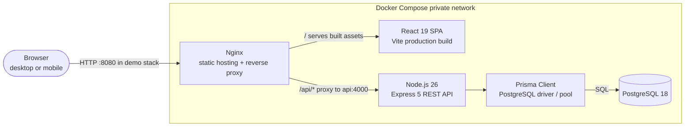
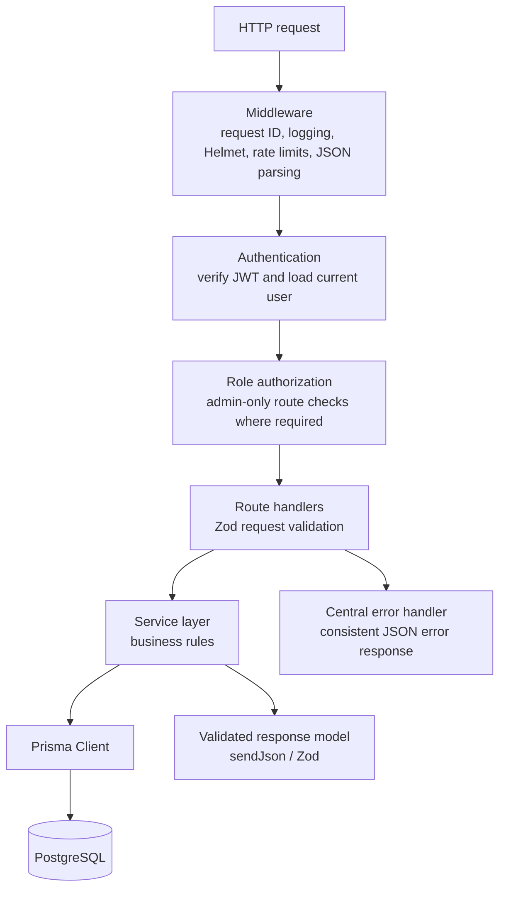
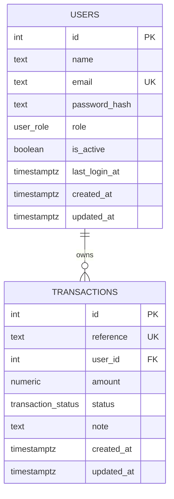
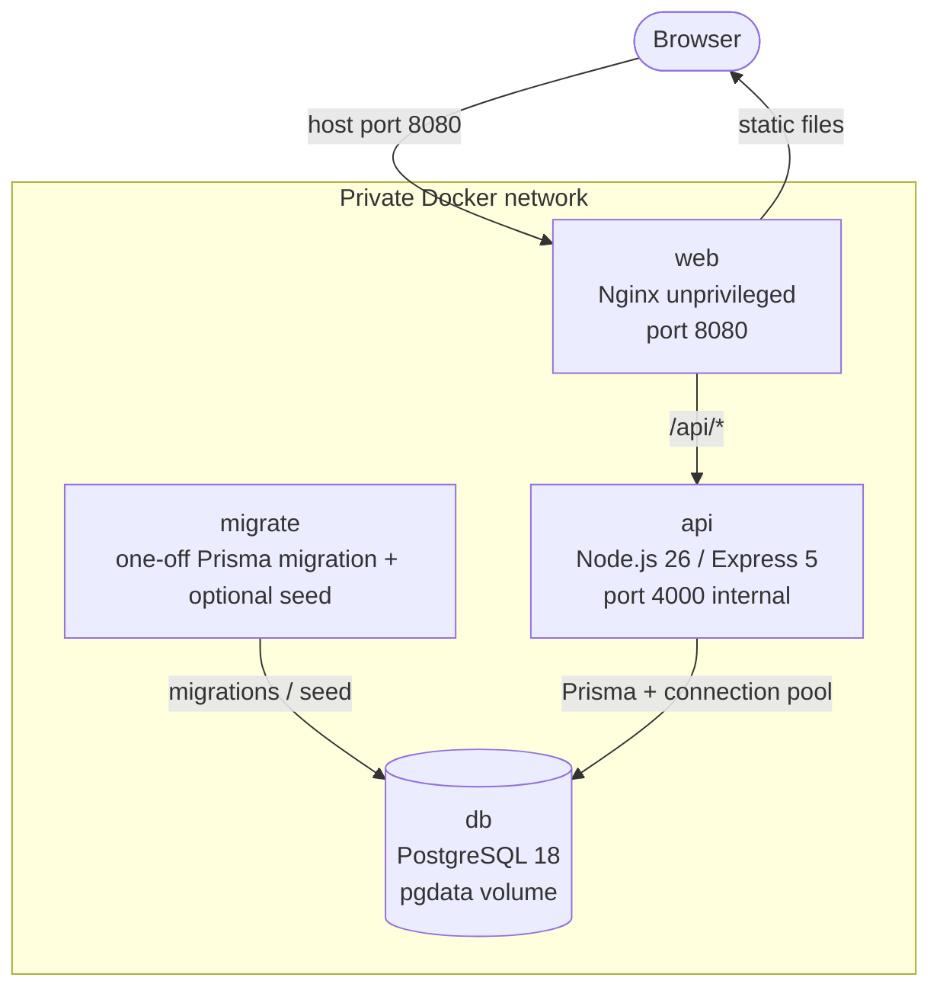

# Ledgerly Architecture

This document describes the architecture implemented in the Ledgerly assessment application. It is based on the checked-in React, Express, Prisma, PostgreSQL, Nginx and Docker Compose configuration.

## Diagram index

The PNG files are ready-to-view diagrams. Matching `.mmd` files are included for editing in Mermaid-compatible tools.

- [System architecture](diagrams/01-system-architecture.png)
- [Backend request flow](diagrams/02-backend-request-flow.png)
- [Database entity relationship](diagrams/03-data-model.png)
- [Docker deployment](diagrams/04-docker-deployment.png)

## 1. System overview

The browser loads the React single-page application from Nginx. The frontend sends API requests to the same origin under `/api/*`; Nginx forwards those requests to the Express API. The API uses Prisma Client and a PostgreSQL connection pool to access PostgreSQL.

- **Frontend (`frontend/`)**: React 19 single-page application built with Vite 8. It calls the backend through same-origin `/api/*` paths.
- **Backend (`backend/`)**: stateless Node.js 26 / Express 5 REST API written in TypeScript.
- **Data access**: Prisma Client, backed by the PostgreSQL driver and connection pool.
- **Database**: PostgreSQL 18. The Prisma schema and migrations define the application data model.
- **Nginx (`frontend/nginx/`)**: serves the Vite build, forwards `/api/*` to the API service, and applies static-content security headers.

**Transport note:** the supplied Docker Compose demo publishes Nginx on host port `8080` and uses HTTP (`http://localhost:8080`). HTTPS is not enabled in this demo stack. For a public production domain, TLS must be added at Nginx or at an upstream TLS terminator; do not interpret the local demo configuration as an HTTPS deployment.

## 2. Backend request flow

| Concern | Implementation location | Responsibility |
|---|---|---|
| Request validation | `backend/src/modules/*/*.schemas.ts` | Zod schemas validate and normalize incoming payloads. |
| Authentication | `backend/src/modules/auth/` and auth middleware | Verifies JWT and loads the current user from the database. |
| Authorization | Role middleware and route definitions | Restricts administrative operations to admins. |
| Business logic | `backend/src/modules/*/*.service.ts` | Implements application rules without coupling them to Express request/response objects. |
| Data access | Prisma Client and `backend/src/db/` | Uses explicit field selections and parameterized database access. |
| Response validation | Module schemas and `sendJson()` in `backend/src/lib/http.ts` | Validates response shapes before sending them. |
| Error handling | `backend/src/lib/errors.ts` and error-handler middleware | Returns a consistent JSON error structure with a request ID. |
| Configuration | `backend/src/config/env.ts` | Validates environment configuration at startup. |

## 3. Data model

- One user can own multiple transactions; each transaction belongs to one user.
- User roles are `admin` and `user`.
- Transaction statuses are `success`, `pending` and `failed`.
- Email uniqueness and lowercase validation are enforced at the database level as well as by application logic.
- The transaction reference is generated from the transaction ID by the database migration.
- The transaction amount uses `numeric(12,2)` and database constraints enforce the permitted range.
- The user foreign key uses `ON DELETE RESTRICT` to prevent deleting users who have transactions.
- Indexes support active-user/role filtering, per-user transaction history, status/date filtering and newest-first transaction listing.

The authoritative definitions are `backend/prisma/schema.prisma` and the migration under `backend/prisma/migrations/`.

## 4. Roles and access control

| Capability | Admin | User |
|---|---:|---:|
| Register through public sign-up | Public sign-up creates a regular user | Yes |
| View dashboard | Workspace-wide figures | Own figures |
| List transactions | All transactions | Own transactions |
| Create transactions | For any active customer | For self |
| View user listing | Yes | No |
| Change roles / activate or deactivate users | Yes, subject to self-change restrictions | No |

Authorization is enforced by the backend, not only by frontend navigation. The backend loads the current user record for requests, so a role change or deactivation is reflected on subsequent requests even if the presented token has not expired.

## 5. Security controls

The implementation includes the following controls, as reflected in the application source and architecture notes:

- Password hashing with Argon2id.
- Short-lived HS256 JWTs with configured issuer, audience and pinned algorithm.
- Generic login failure messages for unknown email and incorrect password.
- Rate limiting for login, registration and general API traffic.
- Helmet security headers, API `Cache-Control: no-store`, request body size limits and removal of the Express identifying header.
- Prisma and tagged parameterized SQL for database access.
- Redaction of authorization credentials and cookies in logs.
- Response schemas and explicit database selections to reduce accidental exposure of sensitive fields.

## 6. Docker deployment architecture

| Compose service | Purpose | Exposure / persistence |
|---|---|---|
| `db` | PostgreSQL 18 database | Private network only; persists data in the `pgdata` named volume. |
| `migrate` | Applies Prisma migrations and optionally loads demo data | One-off job; waits for database health and must complete successfully before the API starts. |
| `api` | Express REST API | Private network only; listens on port `4000`; runs as the non-root `node` user. |
| `web` | Nginx static hosting and reverse proxy | Only published application service; host port defaults to `8080`. |

Startup dependency order is `db` healthy → `migrate` completed successfully → `api` healthy → `web`. The database and API ports are not published directly to the host in the supplied Compose configuration. Container logs use rotation settings configured in Compose, and services use restart policies where appropriate.

## 7. Health checks and operations

- `GET /api/health` is the API liveness endpoint.
- `GET /api/health/ready` checks database readiness and reports connection-pool information; it returns an unavailable response when the database cannot be reached.
- Nginx exposes `/healthz` for its container health check.
- Responses carry an `X-Request-Id`; the same request identifier is included in application logs to support request tracing.
- The API handles `SIGTERM` and `SIGINT` by stopping new work, allowing in-flight requests to finish, closing the database pool and enforcing a shutdown timeout.
- Database outages are intended to surface as `503 SERVICE_UNAVAILABLE` rather than an unhandled generic server error.

## 8. Development versus assessment deployment

In development, Vite serves the frontend and proxies `/api` requests to the backend on port `4000`. In the Docker Compose assessment deployment, Nginx serves the built frontend and proxies `/api/*` to the `api` service over the private Docker network.

The current Compose file is a local/demo deployment configuration. Public HTTPS, certificate issuance/renewal, external monitoring and production backup scheduling are not configured by this architecture document; those should be covered and demonstrated separately under Task 4 if implemented.
